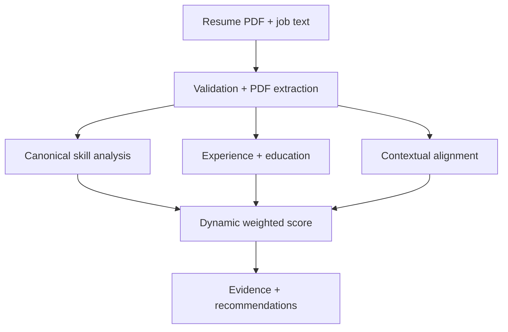

# AI Resume Job Matcher

An in-progress portfolio project that compares a resume with a job description and returns an auditable, evidence-backed match report.

The advanced analysis path is deterministic and works without an OpenAI key. The separate RAG indexing/retrieval path can use OpenAI embeddings and ChromaDB when a key is configured.

## Advanced feature: explainable hybrid analysis

`POST /analyze` accepts a resume PDF and pasted job description, then returns:

* a 0–100 weighted match score and confidence estimate;
* separate coverage for required and preferred skills;
* canonical alias matching (for example, `PySpark` → Apache Spark);
* resume and job evidence snippets for every detected skill;
* experience assessment from explicit tenure or merged date ranges;
* education requirement assessment;
* TF-IDF contextual alignment for responsibilities and achievements;
* must-have gaps and prioritized, truth-safe recommendations;
* dynamic weights that omit requirements the employer did not state.

The engine does not extract or score protected characteristics. It is decision support, not a hiring decision system.

## Architecture



The existing optional RAG path follows PDF → clean/chunk → OpenAI embeddings → ChromaDB → semantic retrieval.

## API endpoints

| Endpoint             | Purpose                                      | API key required |
| -------------------- | -------------------------------------------- | ---------------- |
| `GET /health`        | Health check                                 | No               |
| `POST /analyze`      | Resume PDF + job-description analysis        | No               |
| `POST /analyze/text` | JSON text-to-text analysis                   | No               |
| `GET /explain`       | Scoring method, guardrails, and limitations  | No               |
| `POST /ingest`       | Extract and chunk a PDF                      | No               |
| `POST /index`        | Chunk and index a resume or job PDF          | Yes              |
| `POST /match`        | Retrieve semantically similar indexed chunks | Yes              |

Interactive API documentation is available at `http://127.0.0.1:8000/docs`.

## Local setup

Python 3.11–3.14 is supported. The Windows instructions below use Python 3.14.

### Windows PowerShell

Open the extracted `AI-Resume-Job-Matcher-Advanced` folder in VS Code, then open a terminal and verify Python:

```powershell
py -3.14 --version
```

Create and activate a project-specific virtual environment:

```powershell
py -3.14 -m venv .venv
.\.venv\Scripts\Activate.ps1
```

If PowerShell blocks activation, allow it for the current terminal only:

```powershell
Set-ExecutionPolicy -Scope Process -ExecutionPolicy Bypass
.\.venv\Scripts\Activate.ps1
```

Install the dependencies and create the local configuration:

```powershell
python -m pip install --upgrade pip
python -m pip install -r requirements.txt
Copy-Item .env.example .env
```

Start the backend in this terminal:

```powershell
python -m uvicorn app.main:app --reload --host 127.0.0.1 --port 8000
```

Keep that terminal running. Confirm the API is available:

* Health check: `http://127.0.0.1:8000/health`
* API documentation: `http://127.0.0.1:8000/docs`

Open a second VS Code terminal, activate the same environment, and start the UI:

```powershell
.\.venv\Scripts\Activate.ps1
python -m streamlit run frontend/streamlit_app.py --server.port 8501
```

Open `http://localhost:8501`. Do not open only `http://localhost`; the `:8501` port is required.

### macOS or Linux

```bash
python -m venv .venv
source .venv/bin/activate
python -m pip install --upgrade pip
python -m pip install -r requirements.txt
cp .env.example .env
python -m uvicorn app.main:app --reload --host 127.0.0.1 --port 8000
```

In a second terminal:

```bash
source .venv/bin/activate
python -m streamlit run frontend/streamlit_app.py --server.port 8501
```

`OPENAI_API_KEY` is optional unless you call `/index` or `/match`.

### Starting the application later

There is no need to reinstall dependencies. Start the backend and frontend in two terminals using the commands above. Keep both terminals open while using the application, and press `Ctrl+C` in each terminal to stop it.

### Connection troubleshooting

If the browser shows `ERR_CONNECTION_REFUSED`, the corresponding server is not listening:

1. Confirm the backend terminal displays `Uvicorn running on http://127.0.0.1:8000`.
2. Confirm `http://127.0.0.1:8000/health` returns `{"status":"ok"}`.
3. Confirm the frontend terminal displays `Local URL: http://localhost:8501`.
4. Open `http://localhost:8501`, including the port number.
5. If a terminal displays an error, resolve that error before refreshing the browser.

### Example text request

```bash
curl -X POST http://127.0.0.1:8000/analyze/text \
  -H 'Content-Type: application/json' \
  -d '{
    "resume_text": "Data scientist with Python, SQL, AWS and 4 years of experience building ML APIs.",
    "job_description": "Required: 3+ years of experience with Python, SQL and machine learning. AWS preferred."
  }'
```

## Run tests

```bash
python -m pytest -q
```

The scoring tests cover alias boundaries, required/preferred classification, keyword-stuffing resistance, dynamic weights, date-range experience, education, contextual alignment, and recommendation guardrails.

## Docker

```bash
docker compose up --build
```

Backend: `http://localhost:8000`
Frontend: `http://localhost:8501`

## Current limitations and next milestones

This project is not presented as complete. Current limitations include:

* the curated taxonomy can miss niche skills or equivalents;
* date-range experience is approximate and may include non-relevant work;
* contextual alignment is lexical and does not prove proficiency;
* scanned resumes require OCR before upload;
* the RAG path requires external embeddings and has not yet been benchmarked end to end.

Next milestones are to evaluate at least 15–20 labelled resume/job pairs, calibrate score thresholds, add OCR, test accessibility and deployment, and publish documented precision/error analysis.
